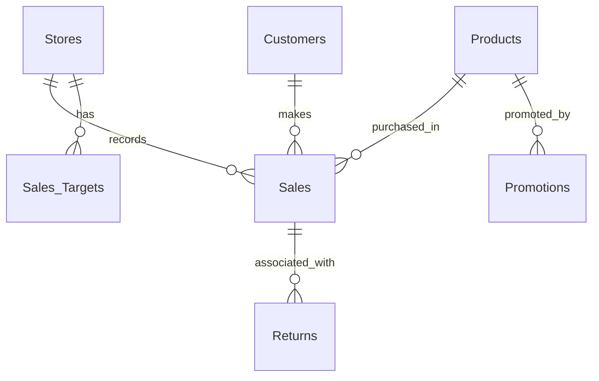

<div align="center">

# Samsung Pakistan | Retail Sales & Channel Performance Analytics

### SQL Server · Relational Data Modeling · Retail Business Intelligence


**Examining retail revenue, channel performance, product demand, returns, targets and customer behavior through structured SQL analysis.**

[Overview](#executive-summary) · [Architecture](#database-architecture) · [Business Questions](#business-questions--sql-analysis) · [Results](#what-the-source-data-supports) · [Quality Review](#technical-review--limitations) · [Recommendations](#business-recommendations)

</div>

<!-- BANNER: Drag the Samsung banner image above the heading in GitHub's README editor.
GitHub will create its own hosted image link. Add it only once. -->

> **Independent portfolio case study:** This is a simulated Samsung Pakistan retail analytics scenario. It does not use verified company transaction data, does not represent actual Samsung Pakistan performance and is not affiliated with or endorsed by Samsung.
>
> **Evidence note:** The supplied SQL script contains a small sample for **January–June 2024**, while the shared dashboard illustration shows **2023**, 25.1K transactions and $1.25M. Those dashboard figures cannot be reconciled to the uploaded SQL sample and must be treated as **conceptual presentation metrics** rather than verified outputs.

---

## Executive Summary

Retail operations span different stores, product categories, promotion periods and distribution channels. Decision-makers need to see not only total sales, but also **where revenue comes from, which products lead each category, whether targets are achieved, why products are returned, and which customers buy repeatedly**.

This project builds a relational SQL Server dataset that simulates the activity of experience stores, distributors and online retail partners across Pakistan. T-SQL queries are used to investigate sales by city, store and channel; rank products; compare sales with monthly targets; analyze return records; and study repeat customers and promotions.

### Project snapshot

| Attribute | Details |
|---|---|
| **Role** | Data Analyst / SQL Developer |
| **Primary implementation** | SQL Server, T-SQL |
| **Business domain** | Consumer electronics retail |
| **Scenario** | Samsung Pakistan sales and channel performance |
| **Sample coverage** | January–June 2024 |
| **Database** | `Samsung_Pakistan` |
| **Tables** | 7 |
| **SQL seed records** | 20 stores, 20 products, 20 customers, 20 sales, 20 returns, 20 targets, 20 promotions |
| **Analysis** | City sales, product ranking, targets, channels, returns, customers and promotions |
| **Dashboard** | Attached Samsung-themed concept image (not independently validated Power BI output) |

### Technical value

- Relational model with primary/foreign keys and separate transactional and master tables.
- Analytical SQL using `JOIN`, `GROUP BY`, aggregations, subqueries, CTEs and window functions.
- Business metrics for sales, customer frequency, return tracking, target variance and cumulative performance.
- Identification of data-grain and metric-definition risks affecting reliable retail reporting.

---

## Business Challenge

A multi-channel electronics business needs consistent answers to questions such as:

1. Which cities and sales channels contribute the most revenue?
2. Which products and categories sell best?
3. Are stores achieving monthly targets?
4. Which customers make repeat purchases or participate in loyalty programs?
5. How do return patterns differ by store and product category?
6. How do sales move over time, and which promotions overlap with recorded transactions?

These questions are the project scenario. They are **not evidence of internal problems at Samsung Pakistan**.

---

## Database Architecture

Seven interconnected tables support the SQL analysis:

| Table | Purpose | Key fields |
|---|---|---|
| `Stores` | Store and channel reference | `StoreID`, `City`, `StoreType` |
| `Products` | Catalog, prices and categories | `ProductID`, `Category`, `CostPrice`, `MSRP` |
| `Customers` | Customer and loyalty attributes | `CustomerID`, `Gender`, `City`, `LoyaltyMember` |
| `Sales` | Sale-level transaction records | `SaleID`, `StoreID`, `ProductID`, `CustomerID`, `SaleDate`, `Quantity`, `Discount`, `NetSales` |
| `Returns` | Recorded return events | `ReturnID`, `SaleID`, `ReturnReason`, `ReturnDate` |
| `Sales_Targets` | Monthly store targets | `TargetID`, `StoreID`, `TargetMonth`, `TargetAmount` |
| `Promotions` | Product campaign periods | `PromotionID`, `ProductID`, `PromotionType`, `DiscountPercent`, `StartDate`, `EndDate` |

### Relationship structure



**Important modeling note:** The uploaded ER diagram appears to connect the `Returns` table to `Products` and `Promotions`. The actual SQL script defines `Returns.SaleID` → `Sales.SaleID` and `Promotions.ProductID` → `Products.ProductID`; no direct foreign key exists between returns and promotions. The diagram should be corrected to match the executable schema.

---

## Business Questions & SQL Analysis

### 01 — City and channel performance

- Rank cities using `SUM(Sales.NetSales)` after joining to `Stores`.
- Calculate channel contribution across **Experience Store**, **Distributor** and **Online**.
- Compare store-level sales and distinguish location from channel (online stores have `City = 'Online'` in this sample).

**Business application:** Investigate the revenue mix before making channel investment decisions.

### 02 — Product and category performance

- Find top-five revenue-generating products.
- Rank models **within each category** with `RANK()`.
- Compare unit volume, revenue and prices instead of treating them as interchangeable.
- Identify products with no recorded sales using an outer join.

**Business application:** Identify assortment concentration and products requiring further investigation.

### 03 — Sales targets

- Compare actual revenue against `Sales_Targets`.
- Calculate the variance between sales and targets.
- Match actual sales and targets **by both store and month**.

**Business application:** Distinguish true target achievement from totals aggregated over mismatched periods.

### 04 — Returns and product quality signals

- Count returns by store and return reason.
- Calculate return rates at a consistent grain, taking care not to multiply sales through incorrect joins.
- Review differences in returned quantities and returned transactions if additional fields become available.

**Business application:** Support follow-up investigation of product quality, fulfillment and customer expectations.

### 05 — Customer retention and loyalty

- Identify customers with more than one sales record.
- Segment customers by loyalty membership and purchase behavior.
- Explore inactivity using a reporting date appropriate to the **2024 sample**, rather than comparing historical records directly with the current system date.

**Business application:** Prepare repeat-purchase analysis and future retention monitoring.

### 06 — Promotions and time trends

- Analyze monthly revenue and cumulative sales with window functions.
- Match sales with product promotion windows.
- Investigate sales associated with promotions, while avoiding causal claims without a before/after comparison and controls.

**Business application:** Evaluate seasonality and design better promotion measurement.

---

## SQL Implementation Highlights

These examples use the table names and column names in the uploaded SQL script. They illustrate corrections needed for reliable metrics; the original script remains unchanged.

### Channel revenue contribution

```sql
SELECT
    st.StoreType,
    SUM(s.NetSales) AS RevenuePKR,
    ROUND(
        100.0 * SUM(s.NetSales) / NULLIF(SUM(SUM(s.NetSales)) OVER (), 0),
        2
    ) AS RevenueSharePct
FROM dbo.Sales AS s
JOIN dbo.Stores AS st ON s.StoreID = st.StoreID
GROUP BY st.StoreType
ORDER BY RevenuePKR DESC;
```

### Monthly store target variance

```sql
WITH StoreMonthSales AS (
    SELECT
        StoreID,
        DATEFROMPARTS(YEAR(SaleDate), MONTH(SaleDate), 1) AS MonthStart,
        SUM(NetSales) AS ActualRevenue
    FROM dbo.Sales
    GROUP BY StoreID, DATEFROMPARTS(YEAR(SaleDate), MONTH(SaleDate), 1)
)
SELECT
    st.StoreName,
    t.TargetMonth,
    t.TargetAmount,
    COALESCE(ms.ActualRevenue, 0) AS ActualRevenue,
    COALESCE(ms.ActualRevenue, 0) - t.TargetAmount AS VariancePKR
FROM dbo.Sales_Targets AS t
JOIN dbo.Stores AS st ON st.StoreID = t.StoreID
LEFT JOIN StoreMonthSales AS ms
    ON ms.StoreID = t.StoreID
   AND ms.MonthStart = t.TargetMonth
ORDER BY t.TargetMonth, st.StoreName;
```

### Return rate by product category

```sql
WITH SaleReturnStatus AS (
    SELECT
        s.SaleID,
        p.Category,
        CASE WHEN EXISTS (
            SELECT 1
            FROM dbo.Returns AS r
            WHERE r.SaleID = s.SaleID
        ) THEN 1 ELSE 0 END AS HasReturn
    FROM dbo.Sales AS s
    JOIN dbo.Products AS p ON p.ProductID = s.ProductID
)
SELECT
    Category,
    COUNT(*) AS SaleRecords,
    SUM(HasReturn) AS SaleRecordsWithReturn,
    ROUND(100.0 * SUM(HasReturn) / NULLIF(COUNT(*), 0), 2) AS ReturnRatePct
FROM SaleReturnStatus
GROUP BY Category
ORDER BY ReturnRatePct DESC;
```

*This measures the share of sale records with at least one return. It is not the share of units returned, because `Returns` contains no `ReturnQty` field.*

### Cumulative revenue by date

```sql
WITH DailySales AS (
    SELECT SaleDate, SUM(NetSales) AS DailyRevenue
    FROM dbo.Sales
    GROUP BY SaleDate
)
SELECT
    SaleDate,
    DailyRevenue,
    SUM(DailyRevenue) OVER (
        ORDER BY SaleDate ROWS BETWEEN UNBOUNDED PRECEDING AND CURRENT ROW
    ) AS RunningRevenue
FROM DailySales
ORDER BY SaleDate;
```

---

## What the Source Data Supports

The supplied SQL seed data contains **20 sales transactions** from January to June 2024, with recorded `NetSales` summing to **PKR 3,157,500**. This is a simple arithmetic check of the literal INSERT values, **not a confirmed SQL Server execution result**.

The dataset also contains 20 returns against 20 sale IDs. In this sample, a sale-record return flag would therefore be 100% if all INSERTs run as intended. That makes the data unsuitable for interpreting real-world product return benchmarks without revising the synthetic seed data.

### Dashboard illustration

The accompanying Samsung-themed dashboard depicts headline metrics such as **$1.25M revenue, 25.1K transactions, 3.1% returns and 18.5% repeat customers**. These **do not correspond to the 20-sale, PKR-denominated SQL seed dataset** and must not be presented as validated outputs from the supplied script.

**Portfolio recommendation:** Keep the dashboard image as an explicitly labelled design mockup until its underlying data and Power BI measures are provided and reconciled. The original and regenerated dashboard images are visual references, not verified exports of an executable `.pbix` file.

<!-- DASHBOARD: If desired, drag the single redesigned dashboard screenshot here.
     GitHub generates the hosted user-attachments image link. -->

---

## Technical Review & Limitations

| Finding | Why it matters | Recommended correction |
|---|---|---|
| `JOIN Sales s ON p.ProductID = p.ProductID` in category return query | Always-true condition produces incorrect row counts | Join `s.ProductID = p.ProductID` and count returned sale IDs distinctly |
| Target joins only by `StoreID` | Sales from different periods may be compared with a single monthly target | Join store and reporting month |
| Return-rate query reports return **counts**, not a rate | High-volume stores may appear worse | Divide qualifying returned sales by qualifying sales |
| Promotions query uses `COUNT(SaleID)` | Counts transactions rather than units | Use `SUM(Quantity)` for units; compare against appropriate baselines |
| `GETDATE()` used for historical inactivity | All 2024 customers may appear inactive in later years | Specify a fixed as-of date for the historical analysis |
| Promotion query uses bare dates in a `NOT BETWEEN` expression | Does not correctly filter active promotions | Compare `StartDate` and `EndDate` with the reporting date |
| Profit calculation mixes row-level cost with aggregated profit | May be mathematically inconsistent | Aggregate revenue and extended costs at the same grain |
| Dashboard shows 2023/USD while SQL sample is 2024/PKR | Visuals cannot be reconciled to source | Rebuild visuals from validated model and consistent currency/year |
| ER diagram does not fully reflect SQL FK definitions | Misrepresents relationship paths | Update ERD to match DDL |

### Reproducibility checklist

- [ ] Run the DDL and seed data on a clean SQL Server test database.
- [ ] Confirm all seven tables contain expected records.
- [ ] Check key uniqueness and foreign-key integrity.
- [ ] Verify `NetSales` equals the sum of the 20 inserted sales values.
- [ ] Reconcile sales by channel, city, product and month with the overall total.
- [ ] Correct target, return and promotion analysis queries.
- [ ] Replace mockup dashboard metrics with verified results.
- [ ] Publish corrected ER diagram and real SQL output screenshots.

---

## Business Recommendations

These recommendations are **hypotheses to investigate**, not reported improvements achieved for Samsung:

| Focus | Potential next step | KPI to monitor |
|---|---|---|
| Channel management | Compare channel revenue with transaction volumes and relevant costs | Net revenue and margin by channel |
| Store performance | Use matched monthly targets and actuals to find gaps | Target attainment % |
| Product assortment | Compare unit sales, revenue and unit economics | Gross profit per product/category |
| Returns | Add return quantity and disposition fields | Returned units and returned-sale rate |
| Customer retention | Track repeat purchases using a longer customer history | Repeat purchase rate |
| Promotions | Compare promoted vs. comparable non-promoted periods | Incremental units and revenue |

---

## Skills Demonstrated

- **Database modeling:** primary keys, foreign keys and seven-table relational schema.
- **SQL querying:** INNER/LEFT JOINs, aggregations, CTEs, subqueries, `CASE`, `RANK()`, `LAG()` and running totals.
- **Retail analytics:** channel comparison, monthly trends, target performance, product ranking and return analysis.
- **Analytical quality:** data-grain checks, consistent denominators, date-window logic and dashboard-to-source reconciliation.
- **Business communication:** framing SQL outputs as operational questions, limitations and actionable recommendations.

---

## Repository Contents & Next Steps

Suggested GitHub organization:

```text
Samsung-Pakistan-Retail-Analytics/
├── README.md
├── Samsung Pakistan.sql
├── Samsung_Pakistan_ER_Diagram.png
└── Dashboard.png
```

Use the actual filenames from the repository. If the images are inserted by **GitHub drag-and-drop**, they will receive hosted `user-attachments` links and do not need to appear in the repository root.

**Future work:** Rebuild the dashboard using verified SQL outputs; correct ERD connections and KPI definitions; validate returns and target calculations; and add a PBIX file if an actual Power BI report is developed.

---

<div align="center">

### About the Analyst

**Khurram Naveed**  
Data Analyst | SQL Server | Power BI | Business Intelligence

[](https://github.com/khurraminsights)
[](https://www.linkedin.com/in/khurram-naveed-0083851aa/)

**Building reliable business insights from structured retail data.**

</div>

