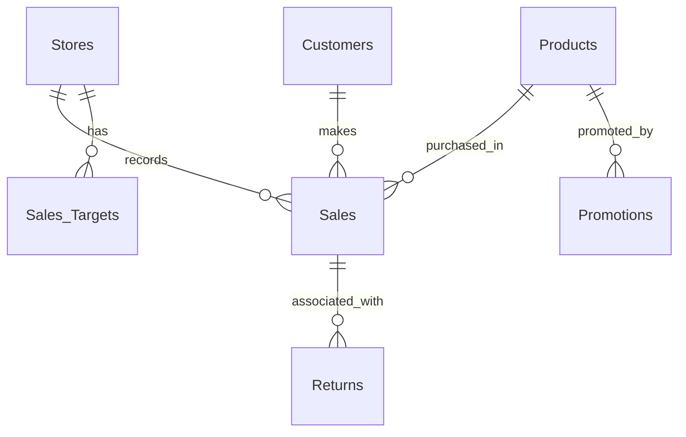

<div align="center">

# Samsung Pakistan | Retail Sales & Channel Performance Analytics


### SQL Server · Retail Analytics · Channel Performance · Customer Insights


**A retail analytics portfolio project focused on revenue performance, sales channels, product demand, customer behavior, returns and target tracking for a Samsung Pakistan business scenario.**

[Executive Summary](#executive-summary) ·
[Dashboard Overview](#dashboard-overview) ·
[Database Architecture](#database-architecture) ·
[SQL Analysis](#business-questions--sql-analysis) ·
[Technical Review](#technical-review--limitations) ·
[Recommendations](#business-recommendations)

</div>

<!--
BANNER:
Drag your Samsung banner image above the project title in GitHub's README editor.

DASHBOARD:
If you are using GitHub drag-and-drop, place the Samsung dashboard image in the Dashboard Overview section below
and replace the placeholder line with GitHub's generated image link.
-->

> **Independent portfolio case study:** This project is an educational Samsung Pakistan retail analytics scenario created for portfolio purposes. It is not affiliated with, endorsed by, or based on official Samsung Pakistan internal data.
>
> **Data note:** The SQL script and the shared dashboard do not fully reconcile with each other. The uploaded SQL file contains a small synthetic sample, while the dashboard presents larger executive KPIs. Therefore, the dashboard should be treated as a **presentation layer / business reporting concept**, not as a fully validated output of the attached SQL dataset.

---

## Executive Summary

Retail businesses need more than total sales numbers to make good decisions. They need to know:

- which **cities** and **channels** generate the most revenue,
- which **products** and **categories** perform best,
- whether stores are meeting **sales targets**,
- how **returns** affect operational performance,
- and whether customers are becoming **repeat buyers**.

This project addresses those business questions through a structured **SQL Server relational database** and a management-style **dashboard view**. It combines data modeling, SQL analysis and business interpretation to simulate how a retail analytics solution could support decision-making for Samsung Pakistan.

### Project Snapshot

| Attribute | Details |
|---|---|
| **Project Title** | Samsung Pakistan – Retail Sales & Channel Performance Analytics |
| **Role** | Data Analyst / SQL Developer |
| **Tools** | SQL Server, T-SQL, Dashboard Reporting |
| **Business Domain** | Consumer Electronics Retail |
| **Project Type** | Independent Portfolio Case Study |
| **Database Name** | `Samsung_Pakistan` |
| **Tables** | 7 related tables |
| **Core Themes** | Sales performance, channels, returns, customers, products, targets, promotions |
| **Dashboard Focus** | Executive KPIs, city sales, product ranking, channel mix, category revenue, repeat customers |

### What This Project Demonstrates

- Relational database design for a retail business scenario
- SQL analysis across transactions, products, customers and store channels
- Executive dashboard storytelling for business users
- Identification of data-quality issues and metric-definition risks
- Translation of technical analysis into recruiter-friendly business insights

---

## Dashboard Overview

Below is the Samsung-themed executive dashboard for this project.


### Dashboard Sections

The dashboard is organized into four decision-making areas:

#### 1. Executive KPI Summary
- Total Revenue
- Total Sales Transactions
- Return Rate (%)
- Repeat Customer Rate (%)

#### 2. Sales Performance
- City-wise sales revenue
- Sales by channel (Experience Store, Distributor, Online)

#### 3. Trend Analysis
- Monthly sales trend
- Cumulative sales growth over time

#### 4. Product Performance & Customer Insights
- Top 5 revenue-generating products
- Product revenue by category
- Stores with highest return rates
- Repeat vs one-time customers

### Dashboard Presentation Note

The dashboard is visually strong and recruiter-friendly, but the displayed KPIs should be treated as **illustrative dashboard figures** unless they are fully reconciled with the SQL data model and calculation logic.

---

## Business Problem

A multi-channel consumer electronics business needs a reliable view of:

1. Which cities contribute the most to total sales?
2. Which sales channel performs best?
3. Which products and categories generate the most revenue?
4. How are sales trending over time?
5. Which stores experience higher return rates?
6. How many customers are repeat buyers versus one-time buyers?
7. Are store targets being achieved?
8. How can promotions and customer behavior be linked to business performance?

This project simulates those questions through a structured SQL-based case study.

---

## Database Architecture

The project uses a 7-table relational model.

| Table | Purpose | Key Fields |
|---|---|---|
| `Stores` | Store, city and sales-channel details | `StoreID`, `StoreName`, `City`, `StoreType` |
| `Products` | Product master data | `ProductID`, `ProductName`, `Category`, `CostPrice`, `MSRP` |
| `Customers` | Customer profiles and loyalty information | `CustomerID`, `Gender`, `City`, `LoyaltyMember` |
| `Sales` | Transaction-level sales records | `SaleID`, `StoreID`, `ProductID`, `CustomerID`, `SaleDate`, `Quantity`, `Discount`, `NetSales` |
| `Returns` | Product return activity | `ReturnID`, `SaleID`, `ReturnReason`, `ReturnDate` |
| `Sales_Targets` | Store-level monthly targets | `TargetID`, `StoreID`, `TargetMonth`, `TargetAmount` |
| `Promotions` | Product campaign and discount periods | `PromotionID`, `ProductID`, `PromotionType`, `DiscountPercent`, `StartDate`, `EndDate` |

### Relationship Structure



### Architecture Note

The SQL schema is well designed for a portfolio case study. However, the uploaded ER diagram should be checked against the actual SQL DDL because some visual relationships may not perfectly reflect the defined foreign keys.

---

## Business Questions & SQL Analysis

### 1. City-Wise Sales Performance
Analyze sales by city to identify the strongest geographic markets.

**Business use:** Helps compare regional contribution and prioritize market focus.

### 2. Sales by Channel
Compare revenue contribution across:
- Experience Store
- Distributor
- Online

**Business use:** Understand channel mix and support channel strategy decisions.

### 3. Top Revenue-Generating Products
Identify the products contributing the highest revenue.

**Business use:** Focus on product winners and support inventory or promotion decisions.

### 4. Category Performance
Compare sales across product categories such as:
- Mobile
- Tablets
- Wearables
- Accessories

**Business use:** Understand category mix and revenue concentration.

### 5. Monthly Sales Trend
Track how revenue changes month by month.

**Business use:** Detect trend movement, seasonality and performance changes.

### 6. Cumulative Growth Over Time
Use running-total logic to examine cumulative sales performance.

**Business use:** Show broader business growth rather than isolated monthly snapshots.

### 7. Returns Analysis
Measure return activity by store, category or product.

**Business use:** Identify operational risk areas and product-quality concerns.

### 8. Repeat Customer Behavior
Distinguish repeat customers from one-time customers.

**Business use:** Support customer retention and loyalty planning.

### 9. Target vs Actual Sales
Compare actual sales against monthly store targets.

**Business use:** Reveal stores performing above or below expectations.

### 10. Promotion Impact
Link promotion records with transaction dates and products.

**Business use:** Explore how campaigns align with recorded sales activity.

---

## SQL Implementation Highlights

The following examples reflect the intended analytical logic for the project.

### Channel Revenue Contribution

```sql
SELECT
    st.StoreType,
    SUM(s.NetSales) AS RevenuePKR,
    ROUND(
        100.0 * SUM(s.NetSales) / NULLIF(SUM(SUM(s.NetSales)) OVER (), 0),
        2
    ) AS RevenueSharePct
FROM dbo.Sales AS s
JOIN dbo.Stores AS st
    ON s.StoreID = st.StoreID
GROUP BY st.StoreType
ORDER BY RevenuePKR DESC;
```

### City-Wise Revenue

```sql
SELECT
    st.City,
    SUM(s.NetSales) AS RevenuePKR
FROM dbo.Sales AS s
JOIN dbo.Stores AS st
    ON s.StoreID = st.StoreID
GROUP BY st.City
ORDER BY RevenuePKR DESC;
```

### Monthly Sales Trend

```sql
SELECT
    DATEFROMPARTS(YEAR(SaleDate), MONTH(SaleDate), 1) AS MonthStart,
    SUM(NetSales) AS MonthlyRevenue
FROM dbo.Sales
GROUP BY DATEFROMPARTS(YEAR(SaleDate), MONTH(SaleDate), 1)
ORDER BY MonthStart;
```

### Repeat Customers

```sql
SELECT
    CustomerID,
    COUNT(*) AS PurchaseCount
FROM dbo.Sales
GROUP BY CustomerID
HAVING COUNT(*) > 1
ORDER BY PurchaseCount DESC;
```

### Return Rate by Category

```sql
WITH SaleReturnStatus AS (
    SELECT
        s.SaleID,
        p.Category,
        CASE
            WHEN EXISTS (
                SELECT 1
                FROM dbo.Returns AS r
                WHERE r.SaleID = s.SaleID
            ) THEN 1
            ELSE 0
        END AS HasReturn
    FROM dbo.Sales AS s
    JOIN dbo.Products AS p
        ON s.ProductID = p.ProductID
)
SELECT
    Category,
    COUNT(*) AS SaleRecords,
    SUM(HasReturn) AS ReturnedSales,
    ROUND(100.0 * SUM(HasReturn) / NULLIF(COUNT(*), 0), 2) AS ReturnRatePct
FROM SaleReturnStatus
GROUP BY Category
ORDER BY ReturnRatePct DESC;
```

---

## What the Source Data Supports

The uploaded SQL script supports a **small synthetic retail sample**. Based on the inserted values previously reviewed:

- the script contains **20 sales transactions**,
- the sample covers **January–June 2024**,
- and the inserted `NetSales` values total **PKR 3,157,500**.

These figures come from the SQL sample structure and do **not** match the dashboard's larger executive figures such as:

- **$1.25M Total Revenue**
- **25.1K Total Sales Transactions**
- **3.1% Return Rate**
- **18.5% Repeat Customer Rate**

### Interpretation Guidance

Because the SQL sample and dashboard are not fully aligned, the correct professional position is:

- treat the **SQL script** as the analytical implementation sample,
- treat the **dashboard** as the executive presentation concept,
- and avoid presenting the dashboard KPIs as confirmed outputs unless they are fully reconciled.

---

## Technical Review & Limitations

| Finding | Why it matters | Recommended fix |
|---|---|---|
| SQL sample and dashboard use different scales | Metrics cannot be directly reconciled | Rebuild dashboard from validated SQL outputs |
| Dashboard appears to use 2023, while SQL sample covers 2024 | Period mismatch affects interpretation | Standardize one reporting period |
| Return-rate logic in original analysis may be inconsistent | Can distort store/category performance | Use returned-sale share at a consistent grain |
| Target comparison needs store + month alignment | Incorrect matching can overstate/understate variance | Join actuals to targets on both store and period |
| Promotions analysis needs date-window logic | Incorrect filtering weakens campaign analysis | Match sale date between `StartDate` and `EndDate` |
| ER diagram may not fully match DDL | Can misrepresent relationship paths | Update ERD to reflect actual schema |

### Reproducibility Checklist

- [ ] Run the SQL script on a clean SQL Server instance
- [ ] Verify all seven tables and foreign keys
- [ ] Confirm seed row counts
- [ ] Recalculate total revenue from `Sales`
- [ ] Reconcile channel, city and product sales totals
- [ ] Validate returns logic
- [ ] Validate repeat-customer logic
- [ ] Rebuild dashboard KPIs from reconciled results

---

## Business Recommendations

These recommendations are analytical next steps, **not achieved business outcomes**.

| Focus Area | Recommendation | KPI to Track |
|---|---|---|
| Channels | Compare revenue and margin by channel | Revenue share, margin by channel |
| Cities | Study top- and low-performing cities | City revenue, average order size |
| Products | Protect high-performing products and review weaker items | Product revenue, units sold |
| Categories | Monitor category concentration and profitability | Category sales, gross profit |
| Returns | Add more return-detail fields for deeper analysis | Return rate, return reasons |
| Customers | Track loyalty and repeat purchasing more rigorously | Repeat rate, loyalty share |
| Promotions | Measure promoted sales against true baselines | Incremental revenue, uplift |

---

## Skills Demonstrated

- Relational database design
- SQL Server and T-SQL
- Retail sales analysis
- Product and channel performance reporting
- Returns analysis
- Customer behavior insights
- Business KPI interpretation
- Dashboard storytelling
- Data-quality review and analytical validation

---

## Suggested Repository Structure

```text
Samsung-Pakistan-Retail-Analytics/
├── README.md
├── Samsung Pakistan.sql
├── Samsung_Pakistan_ER_Diagram.png
└── Samsung_Dashboard.png
```

If you use GitHub drag-and-drop for images, GitHub will create hosted image links automatically and you do not need to keep the images in the repository root.

---

## Final Portfolio Positioning

This project is strong for recruiters because it shows both:
1. **technical capability** through SQL and relational data modeling, and  
2. **business communication** through executive-style dashboarding and operational insight framing.

To make it even stronger, the best next step would be to align the SQL dataset and dashboard metrics so that the visual report becomes fully evidence-backed.

---

<div align="center">

### About the Analyst

**Khurram Naveed**  
Data Analyst | SQL Server | Power BI | Business Intelligence

[](https://github.com/khurraminsights)
[](https://www.linkedin.com/in/khurram-naveed-0083851aa/)

**Turning structured retail data into clear, business-focused insights.**

</div>

